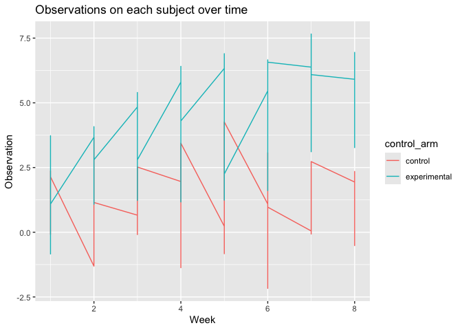
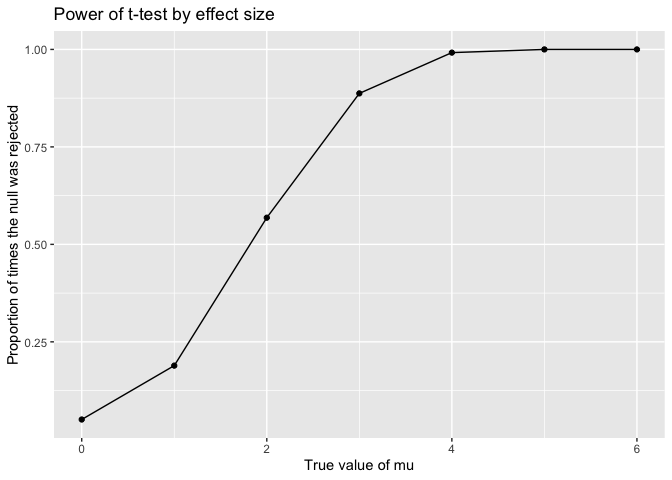
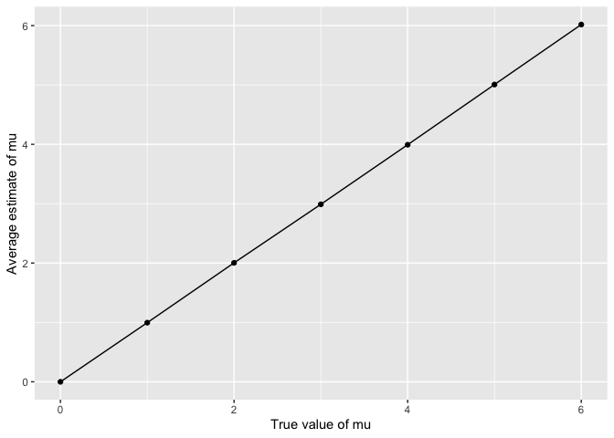
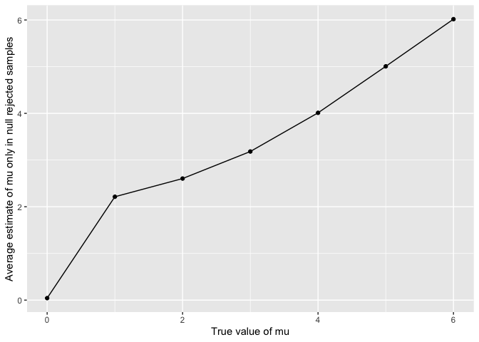

p8105_hw5_sig2127
================

``` r
library(tidyverse)
```

    ## ── Attaching core tidyverse packages ──────────────────────── tidyverse 2.0.0 ──
    ## ✔ dplyr     1.2.1     ✔ readr     2.2.0
    ## ✔ forcats   1.0.1     ✔ stringr   1.6.0
    ## ✔ ggplot2   4.0.3     ✔ tibble    3.3.1
    ## ✔ lubridate 1.9.5     ✔ tidyr     1.3.2
    ## ✔ purrr     1.2.2     
    ## ── Conflicts ────────────────────────────────────────── tidyverse_conflicts() ──
    ## ✖ dplyr::filter() masks stats::filter()
    ## ✖ dplyr::lag()    masks stats::lag()
    ## ℹ Use the conflicted package (<http://conflicted.r-lib.org/>) to force all conflicts to become errors

# Problem 2

## Creating a tidy data frame containing data from all participants, including the subject ID, arm, and observations over time.

## Start with a data frame containing all file names and iterating over file names and reading in data for each subject using purrr::map and saving the result as a new variable in the data frame

``` r
prob_2_df =
  tibble(
    file_names = list.files("Data", full.names = TRUE)) |>
  mutate(data_variable = map(file_names, read_csv))
```

    ## Rows: 1 Columns: 8
    ## ── Column specification ────────────────────────────────────────────────────────
    ## Delimiter: ","
    ## dbl (8): week_1, week_2, week_3, week_4, week_5, week_6, week_7, week_8
    ## 
    ## ℹ Use `spec()` to retrieve the full column specification for this data.
    ## ℹ Specify the column types or set `show_col_types = FALSE` to quiet this message.
    ## Rows: 1 Columns: 8
    ## ── Column specification ────────────────────────────────────────────────────────
    ## Delimiter: ","
    ## dbl (8): week_1, week_2, week_3, week_4, week_5, week_6, week_7, week_8
    ## 
    ## ℹ Use `spec()` to retrieve the full column specification for this data.
    ## ℹ Specify the column types or set `show_col_types = FALSE` to quiet this message.
    ## Rows: 1 Columns: 8
    ## ── Column specification ────────────────────────────────────────────────────────
    ## Delimiter: ","
    ## dbl (8): week_1, week_2, week_3, week_4, week_5, week_6, week_7, week_8
    ## 
    ## ℹ Use `spec()` to retrieve the full column specification for this data.
    ## ℹ Specify the column types or set `show_col_types = FALSE` to quiet this message.
    ## Rows: 1 Columns: 8
    ## ── Column specification ────────────────────────────────────────────────────────
    ## Delimiter: ","
    ## dbl (8): week_1, week_2, week_3, week_4, week_5, week_6, week_7, week_8
    ## 
    ## ℹ Use `spec()` to retrieve the full column specification for this data.
    ## ℹ Specify the column types or set `show_col_types = FALSE` to quiet this message.
    ## Rows: 1 Columns: 8
    ## ── Column specification ────────────────────────────────────────────────────────
    ## Delimiter: ","
    ## dbl (8): week_1, week_2, week_3, week_4, week_5, week_6, week_7, week_8
    ## 
    ## ℹ Use `spec()` to retrieve the full column specification for this data.
    ## ℹ Specify the column types or set `show_col_types = FALSE` to quiet this message.
    ## Rows: 1 Columns: 8
    ## ── Column specification ────────────────────────────────────────────────────────
    ## Delimiter: ","
    ## dbl (8): week_1, week_2, week_3, week_4, week_5, week_6, week_7, week_8
    ## 
    ## ℹ Use `spec()` to retrieve the full column specification for this data.
    ## ℹ Specify the column types or set `show_col_types = FALSE` to quiet this message.
    ## Rows: 1 Columns: 8
    ## ── Column specification ────────────────────────────────────────────────────────
    ## Delimiter: ","
    ## dbl (8): week_1, week_2, week_3, week_4, week_5, week_6, week_7, week_8
    ## 
    ## ℹ Use `spec()` to retrieve the full column specification for this data.
    ## ℹ Specify the column types or set `show_col_types = FALSE` to quiet this message.
    ## Rows: 1 Columns: 8
    ## ── Column specification ────────────────────────────────────────────────────────
    ## Delimiter: ","
    ## dbl (8): week_1, week_2, week_3, week_4, week_5, week_6, week_7, week_8
    ## 
    ## ℹ Use `spec()` to retrieve the full column specification for this data.
    ## ℹ Specify the column types or set `show_col_types = FALSE` to quiet this message.
    ## Rows: 1 Columns: 8
    ## ── Column specification ────────────────────────────────────────────────────────
    ## Delimiter: ","
    ## dbl (8): week_1, week_2, week_3, week_4, week_5, week_6, week_7, week_8
    ## 
    ## ℹ Use `spec()` to retrieve the full column specification for this data.
    ## ℹ Specify the column types or set `show_col_types = FALSE` to quiet this message.
    ## Rows: 1 Columns: 8
    ## ── Column specification ────────────────────────────────────────────────────────
    ## Delimiter: ","
    ## dbl (8): week_1, week_2, week_3, week_4, week_5, week_6, week_7, week_8
    ## 
    ## ℹ Use `spec()` to retrieve the full column specification for this data.
    ## ℹ Specify the column types or set `show_col_types = FALSE` to quiet this message.
    ## Rows: 1 Columns: 8
    ## ── Column specification ────────────────────────────────────────────────────────
    ## Delimiter: ","
    ## dbl (8): week_1, week_2, week_3, week_4, week_5, week_6, week_7, week_8
    ## 
    ## ℹ Use `spec()` to retrieve the full column specification for this data.
    ## ℹ Specify the column types or set `show_col_types = FALSE` to quiet this message.
    ## Rows: 1 Columns: 8
    ## ── Column specification ────────────────────────────────────────────────────────
    ## Delimiter: ","
    ## dbl (8): week_1, week_2, week_3, week_4, week_5, week_6, week_7, week_8
    ## 
    ## ℹ Use `spec()` to retrieve the full column specification for this data.
    ## ℹ Specify the column types or set `show_col_types = FALSE` to quiet this message.
    ## Rows: 1 Columns: 8
    ## ── Column specification ────────────────────────────────────────────────────────
    ## Delimiter: ","
    ## dbl (8): week_1, week_2, week_3, week_4, week_5, week_6, week_7, week_8
    ## 
    ## ℹ Use `spec()` to retrieve the full column specification for this data.
    ## ℹ Specify the column types or set `show_col_types = FALSE` to quiet this message.
    ## Rows: 1 Columns: 8
    ## ── Column specification ────────────────────────────────────────────────────────
    ## Delimiter: ","
    ## dbl (8): week_1, week_2, week_3, week_4, week_5, week_6, week_7, week_8
    ## 
    ## ℹ Use `spec()` to retrieve the full column specification for this data.
    ## ℹ Specify the column types or set `show_col_types = FALSE` to quiet this message.
    ## Rows: 1 Columns: 8
    ## ── Column specification ────────────────────────────────────────────────────────
    ## Delimiter: ","
    ## dbl (8): week_1, week_2, week_3, week_4, week_5, week_6, week_7, week_8
    ## 
    ## ℹ Use `spec()` to retrieve the full column specification for this data.
    ## ℹ Specify the column types or set `show_col_types = FALSE` to quiet this message.
    ## Rows: 1 Columns: 8
    ## ── Column specification ────────────────────────────────────────────────────────
    ## Delimiter: ","
    ## dbl (8): week_1, week_2, week_3, week_4, week_5, week_6, week_7, week_8
    ## 
    ## ℹ Use `spec()` to retrieve the full column specification for this data.
    ## ℹ Specify the column types or set `show_col_types = FALSE` to quiet this message.
    ## Rows: 1 Columns: 8
    ## ── Column specification ────────────────────────────────────────────────────────
    ## Delimiter: ","
    ## dbl (8): week_1, week_2, week_3, week_4, week_5, week_6, week_7, week_8
    ## 
    ## ℹ Use `spec()` to retrieve the full column specification for this data.
    ## ℹ Specify the column types or set `show_col_types = FALSE` to quiet this message.
    ## Rows: 1 Columns: 8
    ## ── Column specification ────────────────────────────────────────────────────────
    ## Delimiter: ","
    ## dbl (8): week_1, week_2, week_3, week_4, week_5, week_6, week_7, week_8
    ## 
    ## ℹ Use `spec()` to retrieve the full column specification for this data.
    ## ℹ Specify the column types or set `show_col_types = FALSE` to quiet this message.
    ## Rows: 1 Columns: 8
    ## ── Column specification ────────────────────────────────────────────────────────
    ## Delimiter: ","
    ## dbl (8): week_1, week_2, week_3, week_4, week_5, week_6, week_7, week_8
    ## 
    ## ℹ Use `spec()` to retrieve the full column specification for this data.
    ## ℹ Specify the column types or set `show_col_types = FALSE` to quiet this message.
    ## Rows: 1 Columns: 8
    ## ── Column specification ────────────────────────────────────────────────────────
    ## Delimiter: ","
    ## dbl (8): week_1, week_2, week_3, week_4, week_5, week_6, week_7, week_8
    ## 
    ## ℹ Use `spec()` to retrieve the full column specification for this data.
    ## ℹ Specify the column types or set `show_col_types = FALSE` to quiet this message.

``` r
prob_2_df
```

    ## # A tibble: 20 × 2
    ##    file_names      data_variable     
    ##    <chr>           <list>            
    ##  1 Data/con_01.csv <spc_tbl_ [1 × 8]>
    ##  2 Data/con_02.csv <spc_tbl_ [1 × 8]>
    ##  3 Data/con_03.csv <spc_tbl_ [1 × 8]>
    ##  4 Data/con_04.csv <spc_tbl_ [1 × 8]>
    ##  5 Data/con_05.csv <spc_tbl_ [1 × 8]>
    ##  6 Data/con_06.csv <spc_tbl_ [1 × 8]>
    ##  7 Data/con_07.csv <spc_tbl_ [1 × 8]>
    ##  8 Data/con_08.csv <spc_tbl_ [1 × 8]>
    ##  9 Data/con_09.csv <spc_tbl_ [1 × 8]>
    ## 10 Data/con_10.csv <spc_tbl_ [1 × 8]>
    ## 11 Data/exp_01.csv <spc_tbl_ [1 × 8]>
    ## 12 Data/exp_02.csv <spc_tbl_ [1 × 8]>
    ## 13 Data/exp_03.csv <spc_tbl_ [1 × 8]>
    ## 14 Data/exp_04.csv <spc_tbl_ [1 × 8]>
    ## 15 Data/exp_05.csv <spc_tbl_ [1 × 8]>
    ## 16 Data/exp_06.csv <spc_tbl_ [1 × 8]>
    ## 17 Data/exp_07.csv <spc_tbl_ [1 × 8]>
    ## 18 Data/exp_08.csv <spc_tbl_ [1 × 8]>
    ## 19 Data/exp_09.csv <spc_tbl_ [1 × 8]>
    ## 20 Data/exp_10.csv <spc_tbl_ [1 × 8]>

## Tidying the result, manipulating file names to include control arm and subject ID, making sure weekly observations are “tidy”, and doing any other tidying that’s necessary

``` r
prob_2_df_tidy =
  prob_2_df |>
  unnest(data_variable) |>
  mutate(
    file_names = str_remove(file_names, "Data/"),
    file_names = str_remove(file_names, ".csv")
  ) |>
  separate(
    file_names,
    into = c("control_arm", "subject_id"),
    sep = "_"
  ) |>
  pivot_longer(
    week_1:week_8,
    names_to = "week",
    names_prefix = "week_",
    values_to = "observation"
  ) |>
  mutate(
    week = as.numeric(week),
    control_arm = case_match(
      control_arm, 
      "con" ~ "control", 
      "exp" ~ "experimental")
  )
```

    ## Warning: There was 1 warning in `mutate()`.
    ## ℹ In argument: `control_arm = case_match(control_arm, "con" ~ "control", "exp"
    ##   ~ "experimental")`.
    ## Caused by warning:
    ## ! `case_match()` was deprecated in dplyr 1.2.0.
    ## ℹ Please use `recode_values()` instead.

``` r
prob_2_df_tidy
```

    ## # A tibble: 160 × 4
    ##    control_arm subject_id  week observation
    ##    <chr>       <chr>      <dbl>       <dbl>
    ##  1 control     01             1        0.2 
    ##  2 control     01             2       -1.31
    ##  3 control     01             3        0.66
    ##  4 control     01             4        1.96
    ##  5 control     01             5        0.23
    ##  6 control     01             6        1.09
    ##  7 control     01             7        0.05
    ##  8 control     01             8        1.94
    ##  9 control     02             1        1.13
    ## 10 control     02             2       -0.88
    ## # ℹ 150 more rows

## Making a spaghetti plot showing observations on each subject over time

``` r
prob_2_df_tidy |>
  ggplot(aes(x = week, y = observation, color = control_arm)) +
  geom_line() +
  labs(
    title = "Observations on each subject over time",
    x = "Week",
    y = "Observation"
  )
```

<!-- -->

Differences between groups: Based on the plot above, it would appear
that the observations on the subjects in the experimental group are
consistently higher than the observations on the subjects in the control
group. The control groups observations sometimes dip into the negatives
as well, which only happens on week 1 for the experimental group. The
experimental group experiences sharp increases in observations between
most weeks, while the control group experiences sharp decreases in
observations between most weeks.

# Problem 3

## Setting the required design elements and running the simulation

``` r
source("source/problem_3.R")

set.seed(1)

sim_prob_3_results = 
  expand_grid(
    mu = 0:6,
    iter = 1:5000
  ) |> 
  mutate(
    est_df = map(mu, prob_3_sim, n_obs = 30, sigma = 5)
  ) |> 
  unnest(est_df) |> 
  mutate(
    reject = p_val < 0.05
  )
```

## Making a plot showing the proportion of times the null was rejected on the y axis and the true value of𝜇on the x axis

Describe the association between effect size and power.

``` r
sim_prob_3_results |> 
  group_by(mu) |> 
  summarize(power = mean(reject)) |> 
  ggplot(aes(x = mu, y = power)) + 
  geom_point() + 
  geom_line() +
  labs(
    x = "True value of mu",
    y = "Proportion of times the null was rejected",
    title = "Power of t-test by effect size"
  )
```

<!-- -->

Describe the association between effect size and power: As we have
learned before, power increases with increasing effect size (μ). When μ
= 0 the null is true, so the proportion of times the null was rejected
is right around 0.05. As μ increases, power also steeply increases. This
steep rise happens for smaller μ values before the curve then flattens
and approaches 1. This flattening happens around μ = 4, and continues
all the way to μ = 6. At μ = 6, the the power is 1, meaning the effect
is almost always detected by the t-test.

## Making a plot showing the average estimate of 𝜇̂ on the y axis and the true value of 𝜇on the x axis.

``` r
sim_prob_3_results |> 
  group_by(mu) |> 
  summarize(avg_est_of_mu = mean(mu_est)) |> 
  ggplot(aes(x = mu, y = avg_est_of_mu)) + 
  geom_point() + 
  geom_line() +
  labs(
    x = "True value of mu",
    y = "Average estimate of mu"
  )
```

<!-- -->

## Making a second plot of the average estimate of 𝜇̂ only in samples for which the null was rejected on the y axis and the true value of 𝜇 on the x axis.

``` r
sim_prob_3_results |> 
  filter(reject) |> 
  group_by(mu) |> 
  summarize(avg_est_of_mu = mean(mu_est)) |> 
  ggplot(aes(x = mu, y = avg_est_of_mu)) + 
  geom_point() + 
  geom_line() +
  labs(
    x = "True value of mu",
    y = "Average estimate of mu only in null rejected samples"
  )
```

<!-- -->

Is the sample average of 𝜇̂ across tests for which the null is rejected
approximately equal to the true value of 𝜇? Why or why not?:

The sample average of 𝜇̂ across tests for which the null is rejected is
not approximately equal to the true value of μ for small values of μ.
Among the tests where the null is rejected, the average of μ̂ is bigger
than the true μ when μ is small. This is the case when μ = 1 or μ = 2.
For larger values of μ (μ = 4, μ = 5, μ = 6), the rejected samples are
much more common, and the average is close to the true μ. At μ = 0, the
average is near 0.
